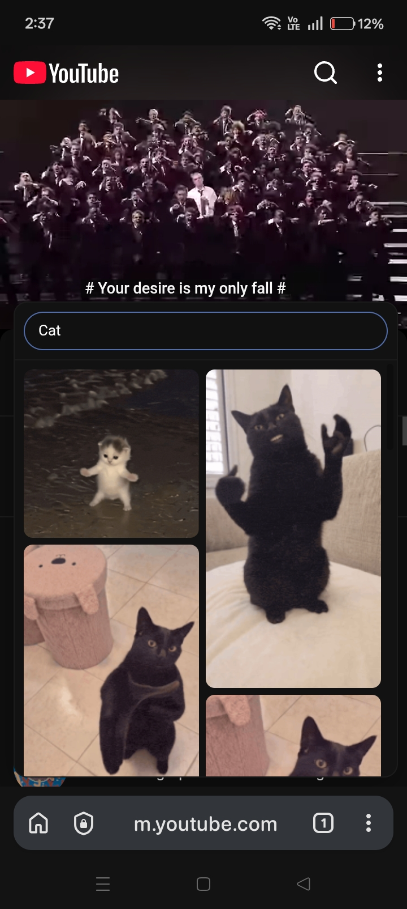
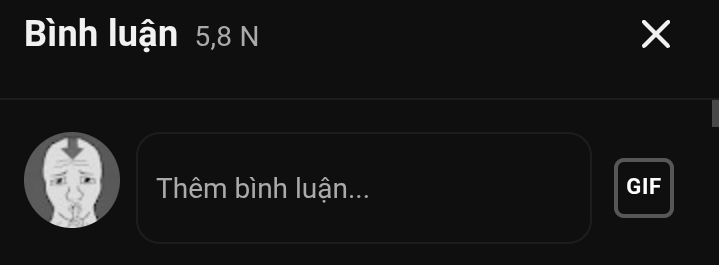

# Mobile Gift

Post GIFs in YouTube comments and replies right from a mobile browser — no desktop tab, no switching to desktop mode.

YouTube's mobile app lets you attach a GIF to a comment, but a mobile browser has no button for it. Mobile Gift adds one next to the emoji button. The GIFs it posts are ordinary YouTube GIF comments, so everyone sees them, with or without the extension.

  
  

The screenshots show the extension's own interface on a test page that stands in for YouTube's comment box.

## Install

Mobile Gift is not on the Chrome Web Store. Load it from this folder:

1. Download or clone this repository.
2. Open `chrome://extensions`.
3. Turn on **Developer mode** (top right).
4. Click **Load unpacked** and choose the `extension` folder.
5. Reload any YouTube tabs that were already open.

It needs Chrome 111 or newer. Other Chromium browsers should work but are untested. Firefox is not supported.

## Use

1. Sign in to YouTube and open a video or a Short.
2. Tap **Add a comment…**, or **Reply** under a comment. A **GIF** button appears next to the emoji button.
3. Tap it. The picker opens with Tenor's featured GIFs.
4. Find a GIF:
   - type to search Tenor, or
   - paste a Tenor link (`tenor.com/view/…`, a `media.tenor.com` file link, or a bare Tenor ID).
5. Tap a GIF. **It is posted straight away**, there is no preview step.

Anything you typed in the comment box is posted together with the GIF.

| Key | What it does |
| --- | --- |
| <kbd>Enter</kbd> | Posts the GIF when the picker shows exactly one result |
| <kbd>Esc</kbd> | Closes the picker |

If YouTube does not send the comment by itself, the picker asks you to press the Comment button. If the post fails, nothing is published and your text stays in the box.

## Limits

- **Unofficial.** Not affiliated with YouTube, Google or Tenor. It sends a field that YouTube's desktop site does not use itself, so it can stop working whenever YouTube changes something.
- **Tenor only.** YouTube's GIF comments take Tenor GIFs. Tenor closed its public API in June 2026, so search results are read from Tenor's web pages and will break if those pages change. Pasting a link keeps working without search.
- **GIFs only.** Stickers and still images are left out of the results.
- **New comments and replies only.** You cannot add a GIF while editing a comment or writing a channel post.

## How it works

| File | Runs in | Job |
| --- | --- | --- |
| `src/content.js`, `src/content.css` | YouTube page, isolated world | Adds the GIF button and the picker |
| `src/main.js` | YouTube page, main world | Rewrites the comment request so it carries the GIF |
| `src/sw.js` | Service worker | Fetches search results from tenor.com |

When you pick a GIF, the content script adds a one-time marker to the comment box and presses YouTube's own Comment button. YouTube builds and signs the request as usual. The main-world script catches that request, removes the marker and adds the GIF's Tenor ID. A marker that cannot be turned into a GIF is blocked, so it never appears as comment text.

## Privacy

The extension has one permission: access to `tenor.com`, used for search. It collects nothing, stores nothing and has no analytics. Search requests go to Tenor without your cookies, and GIF previews load from Tenor's media servers.

## License

Free software: you can redistribute it and/or modify it under the terms of the GNU General Public License as published by the Free Software Foundation, version 3. Distributed without any warranty. See [LICENSE](LICENSE).